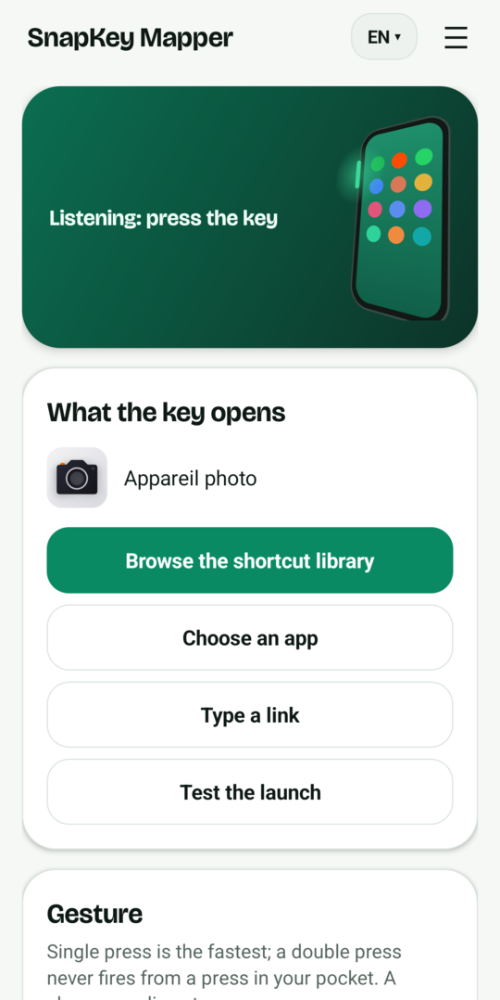

# SnapKey Mapper

Make the side key of your OPPO phone (the "Snap Key") open any app or link you want, with a single press, a double press or a long press. No root, no always-on Wi-Fi, no accessibility service.



A small Android app in Java. It reads the system log, spots the line ColorOS writes each time the side key is pressed, and opens the link or app you chose.

My own use: one press opens a Claude Code Remote Control session, so I can pick up a coding conversation from my pocket. It works just as well for a web page, a note app, a camera app or a deep link.

Website with a longer FAQ: https://remapsnapkey.com/

## Tested and probable devices

| Device | Status |
|---|---|
| OPPO Find X9 Pro, ColorOS 16 (Android 16) | Tested, works |
| OnePlus 15 and other phones with a "Plus Key" or "Action button" built on the same base | Not tested, probably works if the key shows up in the log |
| Any other Android 11+ phone with a hardware key that writes to the log | Not tested |

The app only needs two things: Android 11 or later, and a key press that appears in the system log. Step 3 below tells you how to check that on your phone.

## Two editions

| | `snapkey-mapper.apk` (full, recommended) | `snapkey-mapper-lite.apk` |
|---|---|---|
| Grants the log permission by itself, from the phone | Yes (wireless debugging of the phone, once) | No: you run one `adb` command yourself |
| Android permissions | adds INTERNET, used only for the phone's own wireless debugging | **no INTERNET permission at all** |
| Size | about 12 MB (TLS and cryptography libraries) | about 500 KB (the font of the app) |
| Dependencies | [libadb-android](https://github.com/MuntashirAkon/libadb-android) (Apache-2.0), Conscrypt, sun-security-android | none |

The full edition also adds ACCESS_WIFI_STATE and CHANGE_WIFI_MULTICAST_STATE (to find the pairing service) and ACCESS_NETWORK_STATE (to check that the phone is on Wi-Fi). Everything else is identical. If you want the strongest guarantee, install the lite edition: it has no INTERNET permission, so Android does not let the app open network connections itself.

## Install

1. Download the APK from the [latest release](https://github.com/Damien-llado/snapkey-mapper/releases/latest) and install it.
2. If Android blocks the install, allow your browser or file manager to install unknown apps. Then, in the app info page of SnapKey Mapper, open the three dot menu and choose **Allow restricted settings** (Android shows this for apps installed outside the Play Store). Without it some permissions stay greyed out.
3. Open the app. Allow notifications. Tap **Allow display over other apps** and **Battery: do not restrict**, and enable them. On ColorOS also open the app settings, Battery usage, and pick "No restrictions" or "Allow background activity". Lock the app in the recent apps list.
4. Grant the log permission once (next section). Full edition: the first button of the app does it. Lite edition: with the command.

### Grant the log permission (once)

The app needs `READ_LOGS`, which Android only lets an app receive from the shell.

**Full edition, from the phone alone:**

1. On ColorOS 16, open Developer options and switch on **Disable system optimisation** (see below).
2. Join a Wi-Fi network. Tap **Set up log reading automatically** in the app.
3. In Developer options, turn on **Wireless debugging**, then tap **Pair device with pairing code**.
4. Pull the notification down and type the 6 digits in the reply field.
5. The notification says "Done". Turn Wireless debugging off. The app deletes its pairing key right after the grant.

What the app does in those steps: it finds the pairing service of your own phone on the local network, pairs, runs `pm grant io.github.damienllado.snapkeymapper android.permission.READ_LOGS`, disconnects and deletes its key. The code is in [`SetupService.java`](app/src/full/java/io/github/damienllado/snapkeymapper/SetupService.java) (about 150 lines).

**Other ways (both editions):**

**With a computer and adb** (wireless debugging or USB):

```
adb shell pm grant io.github.damienllado.snapkeymapper android.permission.READ_LOGS
```

**Without a computer, using Key Mapper:**

1. Install Key Mapper (it can run shell commands through ADB mode, using wireless debugging once).
2. On ColorOS 16, open Developer options and switch on **Disable system optimisation**. It is only visible when the phone language is English. Without it the grant fails with `GRANT_RUNTIME_PERMISSIONS` denied. Switching it off again afterwards does not remove the permission.
3. In Key Mapper create a trigger with the action **Shell command**, execution mode **ADB**, and paste the command above (the app has a "Copy the command" button). Press **Test**.
4. The app screen now shows "Log reading: OK".

## Find the name of your key

1. In the app, tap **Start capture**. Android shows a one-time access prompt for the logs: accept.
2. Press the side key two or three times, then tap **Stop capture**.
3. The list shows lines that mention a key. Look for the one that comes back at every press. On the Find X9 Pro it looks like this:

```
KEYLOG_PhoneWindowManagerExtImpl ... KeyEvent { action=ACTION_UP, keyCode=KEYCODE_ACTION_BUTTON_CLICK, scanCode=735 ... eventTime=..., downTime=... }
```

4. Tap that line. The app keeps the stable part of it as the pattern. You can edit the pattern by hand.
5. Nothing shown? Tick "Show all lines", or use **Save the capture to a file** and search it on a computer for the moment you pressed.

## Settings

- **Target**: a link (web address or deep link, opened by whichever app handles it), an `intent:` link (any Android intent: set a timer, an alarm, open the camera...) or an installed app picked from a list. **Test the launch** checks it right away.

Examples of `intent:` links:

```
intent:#Intent;action=android.intent.action.SET_TIMER;i.android.intent.extra.alarm.LENGTH=300;B.android.intent.extra.alarm.SKIP_UI=true;end
intent:#Intent;action=android.intent.action.SET_ALARM;i.android.intent.extra.alarm.HOUR=6;i.android.intent.extra.alarm.MINUTES=30;end
intent:#Intent;action=android.media.action.STILL_IMAGE_CAMERA;end
```
- **Gesture**: one press, two quick presses (default), or long press (500 ms and more). A change applies at once.
- **Listening starts by itself** as soon as the app is set up and something is chosen to open. A silent notification shows how many presses were seen and what happened at the last one, which makes problems easy to spot.

## Set it up with Claude Code

The repository is also a [Claude Code](https://code.claude.com) plugin. It finds the link or intent for what you want the key to do, tests it on your phone over adb, and can install the app and grant its permission for you:

```
/plugin install snapkey-mapper --marketplace Damien-llado/snapkey-mapper
```

Then ask, for example: "make my Snap Key start a 25-minute focus timer". Without the plugin system, copy `plugins/snapkey-mapper/skills/snapkey-mapper` to `~/.claude/skills/`.

## Security and privacy

- **Nothing is collected.** No account, no analytics, no ads, no crash reporting in the app. It stores your target, the key name and the gesture, on the phone only.
- **Do not take my word for it, check:**
  - *Lite edition*: no INTERNET permission, so Android does not let the app open network connections itself (it can still hand a link to another app, which is its job). Check with `aapt dump permissions snapkey-mapper-lite.apk` or with AppVerifier.
  - *Full edition*: INTERNET is declared for one reason, talking to the phone's own wireless debugging. In the code, the only network calls are in `SetupService.java` and the library; there is no URL, no host name and no other socket in the app. After the setup you can also block the network for the app in the ColorOS settings, or just use the lite edition.
  - Both: the source is public and short, the release lists the SHA-256 and the signing certificate fingerprint, and you can build the app yourself from the source (section Build).
- `READ_LOGS` lets an app read the whole system log, which can contain details of what other apps do. The app only looks for your pattern and a few time stamps and keeps nothing; the capture screen holds lines in memory until you close it, and saves a file only when you ask.
- **Fake key presses are ignored:** any app can write lines to the system log, so the app only reacts to lines written by Android itself (uid 1000, read with `logcat -v uid`). Another app cannot make SnapKey Mapper fire your target by writing a fake key line.
- Only do the setup on a Wi-Fi network you trust (turned-on wireless debugging can be pinged by other devices on the same network), and switch the ColorOS option *Disable system optimisation* back on afterwards if you changed it.
- A link in the app that starts with `intent:` runs a full Android intent each time the key is pressed. Paste only links you understand: never one that someone gave you in a chat or a forum without explaining it.
- Report a vulnerability: see [SECURITY.md](SECURITY.md). Licences of the libraries and the font: [THIRD-PARTY-NOTICES.md](THIRD-PARTY-NOTICES.md).
- Signing certificate SHA-256 of the releases, independent of the release page: `a4a6d83d2298e8a88a6da748a3cc9ae9051e459a1d6e06b098a27d2b87f8f796` (`apksigner verify --print-certs`).
- The source is short enough to read in one sitting. Please do.
- After the grant, switch wireless debugging off. The full edition deletes its pairing key itself; you can also remove "SnapKey Mapper" from Wireless debugging › Paired devices.
- To remove everything: uninstall the app.
- Install only from the [GitHub releases](https://github.com/Damien-llado/snapkey-mapper/releases). Each release lists the SHA-256 of the APK and the fingerprint of the signing certificate, so you can check the file (for example with [AppVerifier](https://github.com/soupslurpr/AppVerifier)).
- What Android shows when you install it, and why it is expected: see [Safe to install](https://remapsnapkey.com/#safety) on the website.

## Limits

- Since Android 13, reading the log asks for a one-time access each time listening starts, and the app must be in the foreground at that moment. So after a reboot, tap the notification (or open the app) and start listening again. This is an Android rule, not something the app can skip.
- Not tested outside OPPO phones. Whether the key reaches the log depends on the manufacturer.
- The key keeps appearing in the log even if the Snap Key action is disabled in the OPPO settings, so there is nothing to undo there.
- Some skins kill background services aggressively: follow the battery steps above.

## How it came about

OPPO's settings only let the Snap Key start a closed list of actions. I wanted it to open a specific conversation, so I tried Key Mapper. It only sees the key in its expert mode, which dies as soon as Wi-Fi goes off, so not an option on the road.

Then I noticed ColorOS writes every press into logcat. A capture of the log gave the key's name, `KEYCODE_ACTION_BUTTON_CLICK` with scan code 735. Reading the log needs `READ_LOGS`, which I granted once with Key Mapper's shell command action, after switching on "Disable system optimisation" in the developer options (English only on ColorOS 16, otherwise the grant is refused). Android's "Allow restricted settings" covers an app installed outside the Play Store. And Android 13 and later ask for one-time log access each time listening starts, with the app in the foreground; this comes from the AOSP `LogcatManagerService`.

The result is a small app, tested on the Find X9 Pro since 19 October 2026.

## FAQ

**Does it need root?** No.

**Does it need Wi-Fi?** No. Wireless debugging is only needed once, for the grant.

**Will it work after a reboot?** You have to start listening again (see Limits).

**Is it safe?** No INTERNET permission, short open source code. See Security.

**Can I use it on a phone that is not an OPPO?** Maybe. Capture the log and see whether your key shows up.

More answers on the website.

## Build

Android SDK 35, JDK 17, Gradle 8.14.6 (the repository includes a wrapper pinned to it and `gradle/verification-metadata.xml`, which checks the checksum of every dependency):

```
gradle assembleFullRelease assembleLiteRelease
```

The full edition downloads its three libraries from Maven Central, Google and JitPack at build time.

To sign the release, set `SNAPKEY_KEYSTORE` (path) and `SNAPKEY_KEY_PASSWORD`; the key alias is `snapkey`. Without them you get an unsigned APK.

## License

MIT, see [LICENSE](LICENSE).

## Disclaimer

SnapKey Mapper is an independent project. It is not affiliated with, endorsed by or sponsored by OPPO, OnePlus or Anthropic. OPPO, ColorOS, OnePlus and Claude are trademarks of their respective owners, used here only to describe compatibility.
