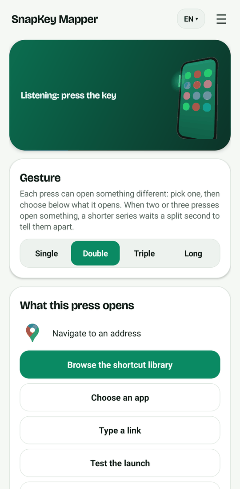
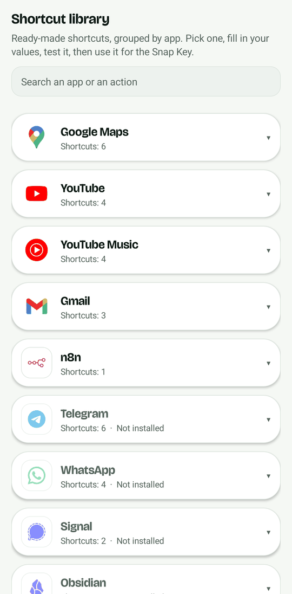
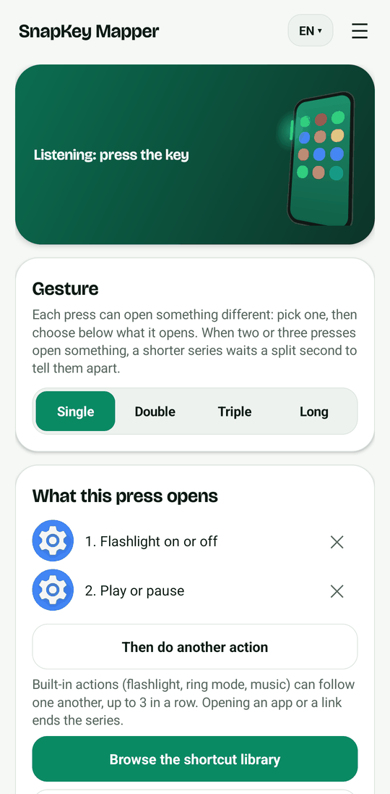
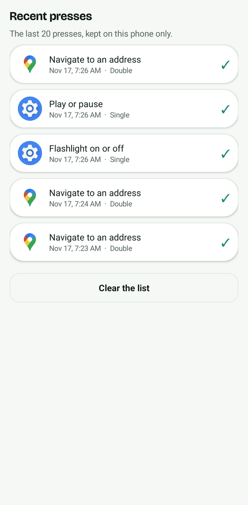

<p align="center"></p>

# SnapKey Mapper

[](https://github.com/Damien-llado/snapkey-mapper/releases/latest)
[](LICENSE)


Make the side key of your phone open what you want: the **Snap Key** of OPPO phones and the **Plus Key** of OnePlus phones. Single, double, triple or long press, each one can open an app, a link, a shortcut, or run a phone action like the flashlight. No root, no always-on Wi-Fi, no accessibility service.

<p align="center">
  
  
  
  
</p>

**[Download the APK](https://remapsnapkey.com/get/github)** · [All releases](https://github.com/Damien-llado/snapkey-mapper/releases/latest) · [Website and FAQ](https://remapsnapkey.com/) · [Changelog](CHANGELOG.md) · [Report a problem](https://github.com/Damien-llado/snapkey-mapper/issues/new/choose)

## Contents

- [What it does](#what-it-does)
- [Compatible devices](#compatible-devices)
- [Quick start](#quick-start)
- [Setup, step by step](#setup-step-by-step)
- [Choose what each press does](#choose-what-each-press-does)
- [Another phone? Find your key](#another-phone-find-your-key)
- [Set it up with Claude Code](#set-it-up-with-claude-code)
- [Two editions](#two-editions)
- [Security and privacy](#security-and-privacy)
- [Limits](#limits)
- [FAQ](#faq)
- [Build from source](#build-from-source)
- [How it came about](#how-it-came-about)
- [Support, license, disclaimer](#support-license-disclaimer)

## What it does

- **One shortcut per gesture**: single, double, triple and long press each open something different.
- **Anything as a target**: an installed app, a web link, a deep link, or an Android `intent:` link (timer, alarm, camera...).
- **Shortcut library**: ready-made shortcuts grouped by app, with the real icons of your phone. Pick one, test it, keep it.
- **Phone actions** without opening anything: flashlight, ring / vibrate / silent, play or pause, next and previous track, voice recorder. Up to 3 actions on one press.
- **Recent presses**: the last 20 presses, what ran and, when it failed, why. A failed action also shows a notification that opens the right screen.
- **Share a shortcut** as a short text (`SKM1 ...`), and paste one you received.
- **Quick settings tile** to turn listening on or off.
- 13 languages. Free, open source (MIT), no ads, no account, nothing collected.

How it works: the app reads the system log, spots the line the system writes each time the side key is pressed, and opens what you chose. My own use: a double press opens a Claude Code session, so I can pick up a coding conversation from my pocket.

## Compatible devices

| Device | Key |
|---|---|
| OPPO Find X9 Pro, ColorOS 16 (Android 16): in daily use on this phone | Snap Key |
| OPPO Find X9, Find X9 Ultra, Find X9s, Find N6 | Snap Key |
| OPPO Find X10, Find X10 Pro Max | Snap Key |
| OPPO Reno 16, Reno 16 Pro, Reno 16 F | AI Snap Key |
| OnePlus 15, 15R, 13s, 13T, Nord 5 | Plus Key |

Not working on yours? [Tell us on GitHub](https://github.com/Damien-llado/snapkey-mapper/issues/new/choose).

The app needs two things: Android 11 or later, and a key press that appears in the system log. On a phone that is not in the list, [find your key](#another-phone-find-your-key) to check.

## Quick start

1. Download [`snapkey-mapper.apk`](https://remapsnapkey.com/get/github) (the latest version; the lite edition is on the [release page](https://github.com/Damien-llado/snapkey-mapper/releases/latest)) and install it.
2. Open the app and follow the setup: four steps, once. The app opens each setting for you and ticks it when it is done.
3. Pick a gesture (single, double, triple, long), then choose what it opens.
4. Press the key.

The sections below give the details of each step, and what to do when something is greyed out.

## Setup, step by step

### 1. Install

1. Download the APK from the [latest release](https://github.com/Damien-llado/snapkey-mapper/releases/latest) and install it.
2. If Android blocks the install, allow your browser or file manager to install unknown apps. Then, in the app info page of SnapKey Mapper, open the three dot menu and choose **Allow restricted settings** (Android shows this for apps installed outside the Play Store). Without it some permissions stay greyed out.
3. Open the app. Allow notifications. Tap **Allow display over other apps** and **Battery: do not restrict**, and enable them. On ColorOS also open the app settings, Battery usage, and pick "No restrictions" or "Allow background activity". Lock the app in the recent apps list.

### 2. Grant the log permission (once)

The app needs `READ_LOGS`, which Android only lets an app receive from the shell. The full edition does it from the phone alone:

1. On ColorOS 16, open Developer options and switch on **Disable system optimisation**. It is only visible when the phone language is English. Without it the grant fails with `GRANT_RUNTIME_PERMISSIONS` denied. Switching it off again afterwards does not remove the permission.
2. Join a Wi-Fi network. Tap **Set up log reading automatically** in the app.
3. In Developer options, turn on **Wireless debugging**, then tap **Pair device with pairing code**.
4. Pull the notification down and type the 6 digits in the reply field.
5. The notification says "Done". Turn Wireless debugging off. The app deletes its pairing key right after the grant.

What the app does in those steps: it finds the pairing service of your own phone on the local network, pairs, runs `pm grant io.github.damienllado.snapkeymapper android.permission.READ_LOGS`, disconnects and deletes its key. The code is in [`SetupService.java`](app/src/full/java/io/github/damienllado/snapkeymapper/SetupService.java) (about 150 lines).

<details>
<summary><b>Other ways to grant it</b> (both editions, the only way for the lite edition)</summary>

**With a computer and adb** (wireless debugging or USB):

```
adb shell pm grant io.github.damienllado.snapkeymapper android.permission.READ_LOGS
```

**Without a computer, using Key Mapper:**

1. Install Key Mapper (it can run shell commands through ADB mode, using wireless debugging once).
2. On ColorOS 16, switch on **Disable system optimisation** as above.
3. In Key Mapper create a trigger with the action **Shell command**, execution mode **ADB**, and paste the command above (the app has a "Copy the command" button). Press **Test**.
4. The app screen now shows "Log reading: OK".

</details>

### 3. Start listening

Listening starts by itself as soon as the app is set up and something is chosen to open. Android asks for a one-time access to the logs at that moment: accept. A silent notification then shows how many presses were seen and what happened at the last one, which makes problems easy to spot.

## Choose what each press does

- **Gesture**: pick single, double, triple or long press (500 ms and more) on the home screen, then choose what it opens. A change applies at once. **Remove** clears a gesture.
- **Target**: an installed app picked from a list, a link (web address or deep link, opened by whichever app handles it) or an `intent:` link (any Android intent). **Test the launch** checks it right away.
- **Shortcut library**: **Browse the shortcut library** lists ready-made shortcuts grouped by app (Claude, Maps, Spotify, the clock, the camera...). Pick one, fill in your values, test it, keep it.
- **Several actions**: a press can run up to 3 built-in actions in a row (flashlight, ring mode, music keys); opening an app or a link ends the series. **Then do another action** adds the next one. Silent mode needs the Do Not Disturb access once; the app opens the right screen.
- **Share a shortcut**: **Copy this shortcut** turns what a press does into a short text (`SKM1 ...`) for a message or a comment; **Paste a shortcut** reads one back, shows what it does and refuses it if it is invalid or aims at an app you do not have.
- **Recent presses**: the last 20 presses with their time, gesture, target and, when it failed, why. Everything stays on the phone.
- **Quick settings tile**: SnapKey turns listening on or off. On opens the app, which starts listening (Android grants the log access only with the app on screen).
- **Restart listening**, at the bottom of the home screen: if shortcuts worked before and stopped, one tap brings the key back.

<details>
<summary><b>Examples of <code>intent:</code> links</b></summary>

```
intent:#Intent;action=android.intent.action.SET_TIMER;i.android.intent.extra.alarm.LENGTH=300;B.android.intent.extra.alarm.SKIP_UI=true;end
intent:#Intent;action=android.intent.action.SET_ALARM;i.android.intent.extra.alarm.HOUR=6;i.android.intent.extra.alarm.MINUTES=30;end
intent:#Intent;action=android.media.action.STILL_IMAGE_CAMERA;end
```

</details>

## Another phone? Find your key

The OPPO Snap Key and the OnePlus Plus Key are already known. On another phone, the key finder checks whether your key reaches the log:

1. In the app, open **Another phone? Find your key** and tap **Start capture**. Android shows a one-time access prompt for the logs: accept.
2. Press the side key two or three times, then tap **Stop capture**.
3. The list shows lines that mention a key. Look for the one that comes back at every press. On the Find X9 Pro it looks like this:

   ```
   KEYLOG_PhoneWindowManagerExtImpl ... KeyEvent { action=ACTION_UP, keyCode=KEYCODE_ACTION_BUTTON_CLICK, scanCode=735 ... eventTime=..., downTime=... }
   ```

4. Tap that line. The app keeps the stable part of it as the pattern (the key code when the line names one). You can edit the pattern by hand.
5. Nothing shown? Tick "Show all lines", or use **Save the capture to a file** and search it on a computer for the moment you pressed.

Found it? **Share your key so it works for everyone** opens a GitHub issue with your phone model and this pattern only, never the rest of the capture.

## Set it up with Claude Code

The repository is also a [Claude Code](https://code.claude.com) plugin. It finds the link or intent for what you want the key to do, tests it on your phone over adb, and can install the app and grant its permission for you:

```
/plugin install snapkey-mapper --marketplace Damien-llado/snapkey-mapper
```

Then ask, for example: "make my Snap Key start a 25-minute focus timer". Without the plugin system, copy `plugins/snapkey-mapper/skills/snapkey-mapper` to `~/.claude/skills/`.

## Two editions

| | `snapkey-mapper.apk` (full, recommended) | `snapkey-mapper-lite.apk` |
|---|---|---|
| Grants the log permission by itself, from the phone | Yes (wireless debugging of the phone, once) | No: you run one `adb` command yourself |
| Android permissions | adds INTERNET, used only for the phone's own wireless debugging | **no INTERNET permission at all** |
| Size | about 12 MB (TLS and cryptography libraries) | about 500 KB (the font of the app) |
| Dependencies | [libadb-android](https://github.com/MuntashirAkon/libadb-android) (Apache-2.0), Conscrypt, sun-security-android | none |

The full edition also adds ACCESS_WIFI_STATE and CHANGE_WIFI_MULTICAST_STATE (to find the pairing service) and ACCESS_NETWORK_STATE (to check that the phone is on Wi-Fi). Everything else is identical. If you want the strongest guarantee, install the lite edition: it has no INTERNET permission, so Android does not let the app open network connections itself.

## Security and privacy

**Nothing is collected.** No account, no analytics, no ads, no crash reporting in the app. It stores your shortcuts, the key pattern and the last 20 presses, on the phone only.

**Do not take my word for it, check:**

- *Lite edition*: no INTERNET permission, so Android does not let the app open network connections itself (it can still hand a link to another app, which is its job). Check with `aapt dump permissions snapkey-mapper-lite.apk` or with AppVerifier.
- *Full edition*: INTERNET is declared for one reason, talking to the phone's own wireless debugging. In the code, the only network calls are in `SetupService.java` and the library; there is no URL, no host name and no other socket in the app. After the setup you can also block the network for the app in the ColorOS settings, or just use the lite edition.
- Both: the source is public and short enough to read in one sitting (please do), and you can [build the app yourself](#build-from-source).

**Check the APK you install:**

- Install only from the [GitHub releases](https://github.com/Damien-llado/snapkey-mapper/releases). Each release lists the SHA-256 of the APK and the fingerprint of the signing certificate, so you can check the file (for example with [AppVerifier](https://github.com/soupslurpr/AppVerifier)).
- Signing certificate SHA-256 of the releases, independent of the release page: `a4a6d83d2298e8a88a6da748a3cc9ae9051e459a1d6e06b098a27d2b87f8f796` (`apksigner verify --print-certs`).
- What Android shows when you install it, and why it is expected: see [Safe to install](https://remapsnapkey.com/#safety) on the website.

**What the permissions allow, and how the app limits it:**

- `READ_LOGS` lets an app read the whole system log, which can contain details of what other apps do. The app only looks for your pattern and a few time stamps and keeps nothing; the capture screen holds lines in memory until you close it, and saves a file only when you ask.
- **Fake key presses are ignored:** any app can write lines to the system log, so the app only reacts to lines written by Android itself (uid 1000, read with `logcat -v uid`). Another app cannot make SnapKey Mapper fire your target by writing a fake key line.
- A link in the app that starts with `intent:` runs a full Android intent each time the key is pressed. Paste only links you understand: never one that someone gave you in a chat or a forum without explaining it.

**During and after the setup:**

- Only do the setup on a Wi-Fi network you trust (turned-on wireless debugging can be pinged by other devices on the same network), and switch the ColorOS option *Disable system optimisation* back on afterwards if you changed it.
- After the grant, switch wireless debugging off. The full edition deletes its pairing key itself; you can also remove "SnapKey Mapper" from Wireless debugging › Paired devices.
- To remove everything: uninstall the app.

Report a vulnerability: see [SECURITY.md](SECURITY.md). Licences of the libraries and the font: [THIRD-PARTY-NOTICES.md](THIRD-PARTY-NOTICES.md).

## Limits

- Since Android 13, reading the log asks for a one-time access each time listening starts, and the app must be in the foreground at that moment. So after a reboot, tap the notification (or open the app, or the quick settings tile) and start listening again. This is an Android rule, not something the app can skip.
- On phones from other makers, whether the key reaches the log depends on the manufacturer.
- The key keeps appearing in the log even if the Snap Key action is disabled in the OPPO settings, so there is nothing to undo there.
- Some skins kill background services aggressively: follow the battery steps of the [setup](#1-install).

## FAQ

**Does it need root?** No.

**Does it need Wi-Fi?** No. Wireless debugging is only needed once, for the grant.

**Will it work after a reboot?** You have to start listening again (see [Limits](#limits)).

**Is it safe?** Nothing is collected, the code is short and open, and the lite edition has no INTERNET permission at all. See [Security and privacy](#security-and-privacy).

**Can I use it on a phone that is not in the list?** Maybe: [find your key](#another-phone-find-your-key) to check whether it reaches the log.

**The key stopped reacting.** Tap **Restart listening** at the bottom of the home screen. Still nothing? Use **Doesn't work on my phone?** in the app, or [open an issue](https://github.com/Damien-llado/snapkey-mapper/issues/new/choose).

More answers on the [website](https://remapsnapkey.com/).

## Build from source

<details>
<summary>Requirements and commands</summary>

Android SDK 35, JDK 17, Gradle 8.14.6 (the repository includes a wrapper pinned to it and `gradle/verification-metadata.xml`, which checks the checksum of every dependency):

```
gradle assembleFullRelease assembleLiteRelease
```

The full edition downloads its three libraries from Maven Central, Google and JitPack at build time.

To sign the release, set `SNAPKEY_KEYSTORE` (path) and `SNAPKEY_KEY_PASSWORD`; the key alias is `snapkey`. Without them you get an unsigned APK.

</details>

## How it came about

<details>
<summary>The story behind the app</summary>

OPPO's settings only let the Snap Key start a closed list of actions. I wanted it to open a specific conversation, so I tried Key Mapper. It only sees the key in its expert mode, which dies as soon as Wi-Fi goes off, so not an option on the road.

Then I noticed ColorOS writes every press into logcat. A capture of the log gave the key's name, `KEYCODE_ACTION_BUTTON_CLICK` with scan code 735. Reading the log needs `READ_LOGS`, which I granted once with Key Mapper's shell command action, after switching on "Disable system optimisation" in the developer options (English only on ColorOS 16, otherwise the grant is refused). Android's "Allow restricted settings" covers an app installed outside the Play Store. And Android 13 and later ask for one-time log access each time listening starts, with the app in the foreground; this comes from the AOSP `LogcatManagerService`.

The result is a small app, in daily use on the Find X9 Pro since 19 October 2026.

</details>

## Support, license, disclaimer

SnapKey Mapper is free and will stay free. If it saves you time, you can [sponsor it on GitHub](https://github.com/sponsors/Damien-llado). A star or a bug report helps too.

License: MIT, see [LICENSE](LICENSE).

SnapKey Mapper is an independent project. It is not affiliated with, endorsed by or sponsored by OPPO, OnePlus or Anthropic. OPPO, ColorOS, OnePlus and Claude are trademarks of their respective owners, used here only to describe compatibility.
